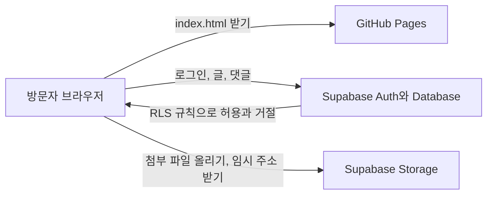

# 삼색펜 구조 문서

기준일: 2026-11-17 (KST)

## 1. 전체 그림

- **GitHub Pages**: `index.html` 을 그대로 보여준다. 저장 기능은 없다.
- **Supabase**: 로그인, 데이터, 파일을 맡는다. 모든 권한은 RLS 규칙으로 서버에서 검사한다.
- **체험 모드**: Supabase 주소와 키가 비어 있으면 같은 화면이 localStorage 로 돌아간다. 코드의 `store` 객체가 두 모드를 같은 함수 이름으로 감싼다.

## 2. index.html 안의 구조

| 부분 | 하는 일 |
| --- | --- |
| `<style>` | 디자인 변수(색, 글꼴)와 화면 모양. 다크모드는 변수만 바꾼다 |
| `NOTICE`, `NOTICE_RULES` | 파일에 고정된 공지 2개 |
| `store` | 저장소 함수 모음. Supabase 판과 체험 판이 같은 이름을 가진다 |
| `views` | 화면 6개: home, list, post, write(edit 포함), login, admin |
| `render()`, `show()` | 주소의 `#` 뒤를 읽어 화면을 그린다 |
| 이벤트 | `click`, `submit`, `change` 를 문서 전체에서 한 번에 받는다 |

### 화면 주소

| 주소 | 화면 |
| --- | --- |
| `#` | 첫 화면 |
| `#list` | 글 목록 |
| `#post-<글번호>` | 글 상세. 공지는 `#post-notice`, `#post-notice-rules` |
| `#write` / `#edit-<글번호>` | 글쓰기 / 글 수정 (관리자만) |
| `#login` | 로그인과 회원가입 |
| `#admin` | 관리자 로그인과 회원 관리 |
| `#admin-comments` | 관리자 댓글 현황 (전체, 오늘, 숨겨진 댓글) |

### store 함수

| 함수 | 설명 |
| --- | --- |
| `session`, `signIn`, `signUp`, `signOut`, `role` | 로그인과 등급 |
| `members`, `setMember` | 회원 목록, 경고와 추방 |
| `list`, `create`, `update`, `remove` | 글 |
| `comments`, `addComment(postId, body, parentId)`, `editComment`, `removeComment(id, soft)` | 댓글과 답글. soft 는 삭제 표시 |
| `allComments` | 관리자 댓글 현황용 전체 댓글 |
| `uploadFiles`, `removeFiles`, `fileUrls`, `attMax` | 첨부 파일 |

## 3. 데이터 표 (supabase-setup.sql)

### profiles (회원 등급)
| 칸 | 뜻 |
| --- | --- |
| id | auth.users 와 같은 사용자 번호 |
| email | 이메일 |
| role | `member`, `banned`, `admin` |
| warns | 경고 횟수 0~3 |
| created_at | 가입 시각 |

- 가입하면 `handle_new_user` 트리거가 `member` 로 만든다.
- `profiles_guard` 트리거: 경고 3회면 `banned`, 추방 되돌리면 경고 0, 관리자는 바뀌지 않음, 화면에서 관리자 지정 불가.

### posts (글)
| 칸 | 뜻 |
| --- | --- |
| id, author_id | 글 번호, 쓴 사람 |
| title, body, category | 제목(120자), 본문(5만 자), 카테고리(20자) |
| visibility | `public` 또는 `private`(관리자 초안) |
| attachments | 첨부 목록 JSON 배열, 5개까지. `{path, name, type, size}` |
| created_at, updated_at | 쓴 시각, 고친 시각 |

### comments (댓글)
| 칸 | 뜻 |
| --- | --- |
| post_id | 글 번호. 공지 댓글을 위해 글자로 저장 (`notice`, `notice-rules`) |
| author_id, author_name | 쓴 사람, 가린 이름. **둘 다 서버 트리거가 정한다** |
| body | 1000자까지 |
| parent_id | 답글이면 부모 댓글 번호. 한 단계만 (트리거가 모음) |
| deleted | 답글이 달린 댓글을 지우면 true, 본문은 "삭제된 댓글입니다" |

### storage: attachments 보관함
- 비공개 보관함. 파일당 10MB, `image/jpeg`, `image/png`, `image/gif`, `application/pdf` 만 받는다.
- 파일 경로: `<글번호>/<시각>-<순번>.<확장자>`. 경로 첫 칸이 글 번호라서 읽기 규칙이 글의 공개 여부를 확인할 수 있다.
- 화면에는 1시간짜리 임시 주소(signed URL)로 보여준다.

## 4. 권한 규칙 (RLS)

| 표 | 읽기 | 쓰기 | 고치기 | 지우기 |
| --- | --- | --- | --- | --- |
| profiles | 본인, 관리자 | 트리거만 | 관리자 | 없음 |
| posts | 공개글은 누구나, 초안은 관리자 | 관리자 | 관리자 | 관리자 |
| comments | 누구나. 단 추방된 회원 댓글은 관리자만 | 회원, 관리자 | 본인 (추방되면 불가), 관리자는 삭제 표시만 | 답글 없는 본인 댓글, 관리자 |
| storage.objects | 공개글 파일은 누구나, 초안 파일은 관리자 | 관리자 | 없음 | 관리자 |

보조 함수: `my_role()` 지금 사용자의 등급, `role_of(uid)` 특정 사용자의 등급, `has_replies(id)` 답글 여부. 모두 security definer.

`comments_fill` 트리거: 작성자와 이름을 서버가 정하고, 답글의 답글을 부모로 모으고, 다른 글의 댓글에 단 답글을 거절하고, 남이 고치면 삭제 표시로 바꾸고, 삭제 표시된 댓글은 고치지 못하게 한다.

## 5. 첨부 파일 검사

| 단계 | 어디서 | 무엇을 |
| --- | --- | --- |
| 1 | 화면 `checkFile()` | 확장자가 jpg, jpeg, png, gif, pdf 인지 |
| 2 | 화면 | 브라우저가 알려준 형식과 확장자가 맞는지 |
| 3 | 화면 | 파일 앞 몇 바이트(서명)가 실제 형식과 맞는지 |
| 4 | 화면 | 크기: 실제 10MB, 체험 1MB. 글당 5개 |
| 5 | 서버 보관함 | 형식 목록과 10MB 제한 |
| 6 | 서버 표 | attachments 5개 제한 |

## 6. 알려진 한계

- 공지는 `index.html` 에 고정. 바꾸려면 파일을 고쳐 다시 배포해야 한다.
- 관리 기록 표가 없다. 경고와 삭제의 사유를 저장하지 않는다.
- 체험 모드의 데이터는 그 브라우저에만 있다.
- 사진의 위치 정보(EXIF)를 지우지 않는다.
