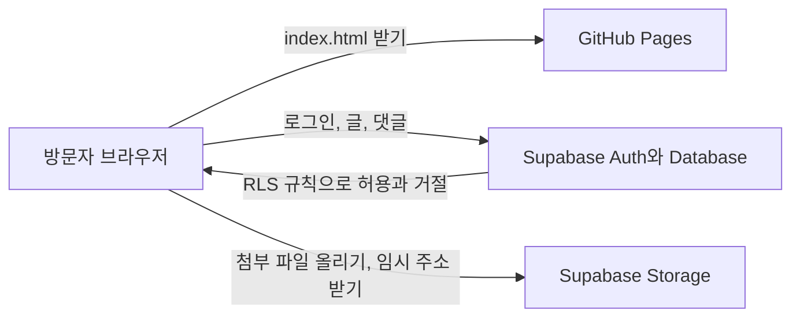
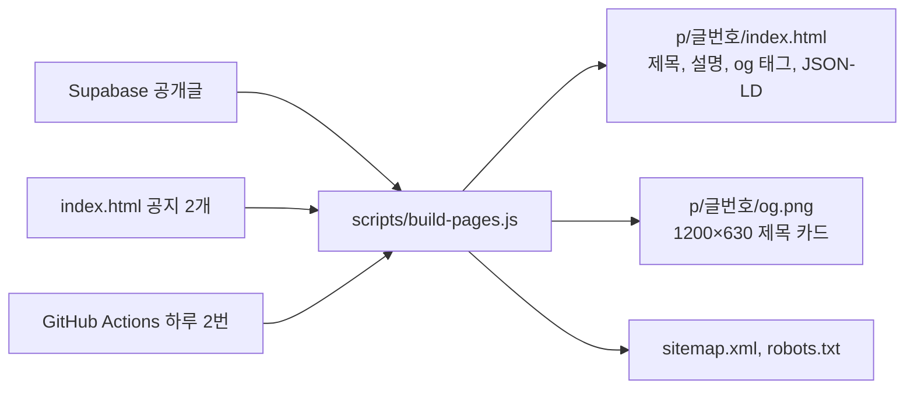
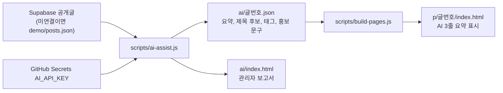

# 생각하는 공방 구조 문서

기준일: 2026-11-17 (KST)

## 1. 전체 그림

- **GitHub Pages**: `index.html` 을 그대로 보여준다. 저장 기능은 없다.
- **Supabase**: 로그인, 데이터, 파일을 맡는다. 모든 권한은 RLS 규칙으로 서버에서 검사한다.
- **검색·공유 페이지**: GitHub Actions 가 하루 두 번 `scripts/build-pages.js` 를 돌려 글마다 `p/<글번호>/index.html` 과 썸네일 `og.png` 를 만들어 올린다. 8장 참고.
- **체험 모드**: Supabase 주소와 키가 비어 있으면 같은 화면이 localStorage 로 돌아간다. 코드의 `store` 객체가 두 모드를 같은 함수 이름으로 감싼다.

## 2. index.html 안의 구조

| 부분 | 하는 일 |
| --- | --- |
| `<style>` | 디자인 변수(색, 글꼴)와 화면 모양. 다크모드는 변수만 바꾼다 |
| `NOTICE`, `NOTICE_RULES` | 파일에 고정된 공지 2개 |
| `store` | 저장소 함수 모음. Supabase 판과 체험 판이 같은 이름을 가진다 |
| `views` | 화면 6개: home, list, post, write(edit 포함), login, admin |
| `render()`, `show()` | 주소의 `#` 뒤를 읽어 화면을 그린다 |
| 이벤트 | `click`, `submit`, `change` 를 문서 전체에서 한 번에 받는다 |

### 화면 주소

| 주소 | 화면 |
| --- | --- |
| `#` | 첫 화면 |
| `#list` | 글 목록 |
| `#post-<글번호>` | 글 상세. 공지는 `#post-notice`, `#post-notice-rules` |
| `#write` / `#edit-<글번호>` | 글쓰기 / 글 수정 (관리자만) |
| `#login` | 로그인과 회원가입 |
| `#admin` | 관리자 로그인과 회원 관리 |
| `#admin-comments` | 관리자 댓글 현황 (전체, 오늘, 숨겨진 댓글) |

### store 함수

| 함수 | 설명 |
| --- | --- |
| `session`, `signIn`, `signUp`, `signOut`, `role` | 로그인과 등급 |
| `members`, `setMember` | 회원 목록, 경고와 추방 |
| `list`, `create`, `update`, `remove` | 글 |
| `comments`, `addComment(postId, body, parentId)`, `editComment`, `removeComment(id, soft)` | 댓글과 답글. soft 는 삭제 표시 |
| `allComments` | 관리자 댓글 현황용 전체 댓글 |
| `uploadFiles`, `removeFiles`, `fileUrls`, `attMax` | 첨부 파일 |

## 3. 데이터 표 (supabase-setup.sql)

### profiles (회원 등급)
| 칸 | 뜻 |
| --- | --- |
| id | auth.users 와 같은 사용자 번호 |
| email | 이메일 |
| role | `member`, `banned`, `admin` |
| warns | 경고 횟수 0~3 |
| created_at | 가입 시각 |

- 가입하면 `handle_new_user` 트리거가 `member` 로 만든다.
- `profiles_guard` 트리거: 경고 3회면 `banned`, 추방 되돌리면 경고 0, 관리자는 바뀌지 않음, 화면에서 관리자 지정 불가.

### posts (글)
| 칸 | 뜻 |
| --- | --- |
| id, author_id | 글 번호, 쓴 사람 |
| title, body, category | 제목(120자), 본문(5만 자), 카테고리(20자) |
| summary | 검색 설명(선택, 160자). 검색 결과와 공유 미리보기에 쓴다. 비면 본문 앞 120자 |
| visibility | `public` 또는 `private`(관리자 초안) |
| attachments | 첨부 목록 JSON 배열, 5개까지. `{path, name, type, size}` |
| created_at, updated_at | 쓴 시각, 고친 시각 |

### comments (댓글)
| 칸 | 뜻 |
| --- | --- |
| post_id | 글 번호. 공지 댓글을 위해 글자로 저장 (`notice`, `notice-rules`) |
| author_id, author_name | 쓴 사람, 가린 이름. **둘 다 서버 트리거가 정한다** |
| body | 1000자까지 |
| parent_id | 답글이면 부모 댓글 번호. 한 단계만 (트리거가 모음) |
| deleted | 답글이 달린 댓글을 지우면 true, 본문은 "삭제된 댓글입니다" |

### storage: attachments 보관함
- 비공개 보관함. 파일당 10MB, `image/jpeg`, `image/png`, `image/gif`, `application/pdf` 만 받는다.
- 파일 경로: `<글번호>/<시각>-<순번>.<확장자>`. 경로 첫 칸이 글 번호라서 읽기 규칙이 글의 공개 여부를 확인할 수 있다.
- 화면에는 1시간짜리 임시 주소(signed URL)로 보여준다.

## 4. 권한 규칙 (RLS)

| 표 | 읽기 | 쓰기 | 고치기 | 지우기 |
| --- | --- | --- | --- | --- |
| profiles | 본인, 관리자 | 트리거만 | 관리자 | 없음 |
| posts | 공개글은 누구나, 초안은 관리자 | 관리자 | 관리자 | 관리자 |
| comments | 누구나. 단 추방된 회원 댓글은 관리자만 | 회원, 관리자 | 본인 (추방되면 불가), 관리자는 삭제 표시만 | 답글 없는 본인 댓글, 관리자 |
| storage.objects | 공개글 파일은 누구나, 초안 파일은 관리자 | 관리자 | 없음 | 관리자 |

보조 함수: `my_role()` 지금 사용자의 등급, `role_of(uid)` 특정 사용자의 등급, `has_replies(id)` 답글 여부. 모두 security definer.

`comments_fill` 트리거: 작성자와 이름을 서버가 정하고, 답글의 답글을 부모로 모으고, 다른 글의 댓글에 단 답글을 거절하고, 남이 고치면 삭제 표시로 바꾸고, 삭제 표시된 댓글은 고치지 못하게 한다.

## 5. 첨부 파일 검사

| 단계 | 어디서 | 무엇을 |
| --- | --- | --- |
| 1 | 화면 `checkFile()` | 확장자가 jpg, jpeg, png, gif, pdf 인지 |
| 2 | 화면 | 브라우저가 알려준 형식과 확장자가 맞는지 |
| 3 | 화면 | 파일 앞 몇 바이트(서명)가 실제 형식과 맞는지 |
| 4 | 화면 | 크기: 실제 10MB, 체험 1MB. 글당 5개 |
| 5 | 서버 보관함 | 형식 목록과 10MB 제한 |
| 6 | 서버 표 | attachments 5개 제한 |

## 6. 방문 통계 (GA4)

- `GA_MEASUREMENT_ID` 가 있을 때만 gtag.js 를 불러온다. 자동 page_view 는 끄고(`send_page_view: false`) 화면이 바뀔 때 `trackPageView()` 가 직접 보낸다.
- GA4 는 page_location(전체 주소)으로 경로를 정한다. 글(`#post-12`)은 검색·공유 페이지와 같은 실제 주소 `p/12/` 로 보내서, 어느 쪽으로 읽어도 GA 에서 한 줄로 모인다. 정적 페이지도 같은 `post_view` 를 보낸다. 자세한 표는 `docs/ANALYTICS.md` 3장.
- 관리자는 `traffic_type=internal` 로 표시해 GA 에서 거른다.
- 방문자가 화면 맨 아래 "방문 통계 끄기"를 누르면 localStorage 에 기억하고 GA 를 멈춘다.
- 이벤트 목록과 규칙: `docs/ANALYTICS.md`

## 7. 알려진 한계

- 첫 화면은 메인 사진 띠, 가운데 한 줄 글 카드(최근 글 5편, 사진 칸은 공지면 `assets/notice-card.jpg`, 아니면 `p/<글번호>/og.png`, 없으면 제목 첫 글자), "전체 글 보기" 버튼 순서다(11-24 변경). 쉬어가기(고양이, 포켓몬)는 같은 날 없앴고, 외부 API 를 부르는 곳은 이제 없다. 계정 상자는 헤더의 "내 계정" 메뉴 안에 있다.
- 포트폴리오 안내 챗봇(11-24): 모든 화면 오른쪽 아래 말풍선. `portfolio/profile.md` → `scripts/ai-assist.js`(자동 실행 때 AI 가 질문과 답 5~8개를 만듦) → `ai/chatbot/qa.js` → 화면이 읽음. 방문자가 물을 때 AI 를 부르지 않아 키가 끝난 뒤에도 답한다. 직접 적은 질문은 낱말로 가장 가까운 준비된 답을 고르고, 없으면 준비된 질문을 고르라고 안내한다.
  - 그림(11-24): 자료의 `` 줄을 코드가 뽑아 그 주제의 답 아래에 붙인다(AI 는 주소를 보지 않음). 설명이 `영상:` 으로 시작하면 영상의 한 장면 jpg 에 "영상 미리보기 · 재생 안 됨" 표시만 하고 재생하지 않는다. 화면과 생성기 모두 `assets/portfolio/` 안의 jpg, png, gif, webp 만 받는다.
  - 자유 질문(11-25): 자료와 공개글(제목, 본문 앞 1500자)로 질문 25~40개를 미리 만든다. 대표 질문 8개(chip)만 버튼으로 보이고 나머지는 숨은 질문이다. 질문마다 다르게 묻는 말(alts) 2~5개를 함께 만들어 적은 질문을 낱말로 맞춘다. 글로 만든 답은 "이 글 읽기" 링크(`#post-<번호>`, 실제 공개글 번호만)를 붙인다. 맞는 답이 없으면 블로그와 포트폴리오 질문만 답한다고 알리고 질문 버튼을 다시 연다. 방문자가 물을 때 AI 를 부르지 않는 규칙은 그대로다.
  - 준비된 질문 영역(11-24): 질문을 고르거나 적어 보내면 접혀서 답과 그림 자리가 넓어진다. "준비된 질문 보기 (N개)" 를 누르면 다시 펼친다.

- 새 글의 검색·공유 페이지는 Actions 가 돌아야 생긴다. 최대 반나절 늦다. 바로 필요하면 Actions 에서 직접 실행한다.

- 공지는 `index.html` 에 고정. 바꾸려면 파일을 고쳐 다시 배포해야 한다.
- 관리 기록 표가 없다. 경고와 삭제의 사유를 저장하지 않는다.
- 체험 모드의 데이터는 그 브라우저에만 있다.
- 사진의 위치 정보(EXIF)를 지우지 않는다.

## 8. 검색과 공유 미리보기

**왜 따로 만드나.** 블로그는 `index.html` 한 장이 `#post-12` 같은 주소로 화면을 바꾼다. 검색엔진과 카카오톡, 페이스북, X 의 미리보기는 `#` 뒤를 다른 페이지로 보지 않고, 대부분 자바스크립트를 실행하지 않는다. 그래서 글마다 진짜 주소를 가진 HTML 파일을 미리 만든다.

| 파일 | 내용 |
| --- | --- |
| `scripts/build-pages.js` | 생성기. 의존 패키지 없음(썸네일만 Playwright). 공개글만 만들고, 공개가 아니게 된 글의 폴더는 지운다 |
| `p/<글번호>/index.html` | 글 제목, 설명, 대표 주소(canonical), og/twitter 태그, BlogPosting 구조화 데이터, 본문, "블로그에서 보고 댓글 달기" 링크 |
| `p/<글번호>/og.png` | 글마다 다른 썸네일. 제목, 본문 앞줄(파랑, 남색, 연파랑 표시, 사진 없으면 4줄), 날짜를 넣는다. 글에 사진(JPG, PNG, GIF)이 첨부돼 있으면 첫 사진을 오른쪽에 넣는다. 사진은 공개용 키로 임시 주소를 받아 내려받고, 파일 앞부분으로 형식을 다시 확인한다 |
| `og/site.png` | 첫 화면 공유용 카드 |
| `sitemap.xml`, `robots.txt` | 검색엔진에 페이지 목록을 알려준다 |
| `.github/workflows/seo-pages.yml` | 매일 06:17, 18:17 KST 와 index.html 이 바뀔 때 생성기를 돌리고 바뀐 파일을 커밋 |

- 설명 순서: 글의 `summary` → 없으면 본문 앞 120자.
- 썸네일 주소 끝에 `?v=<고친 시각><카드 디자인 번호>` 를 붙인다. 카드 모양을 바꾸면 `CARD_DESIGN` 값을 바꾼다. 카카오톡은 그림을 주소 기준으로 오래 기억하므로, 글을 고치면 주소가 바뀌어 새 그림을 가져간다.
- 글 상세 화면의 "공유 링크 복사"는 `p/<글번호>/` 주소를 준다. 나만보기 글에는 버튼이 없다.
- 화면이 바뀔 때 `meta description` 도 바꾸지만, 이것은 자바스크립트를 실행하는 검색엔진에만 의미가 있다.
- `p/`, `og/`, `sitemap.xml`, `robots.txt` 는 **생성 결과물이다. 손으로 고치지 않는다.** `tests/pages_test.js` G12 가 확인한다.

## 9. AI 도우미 (2026-11-23 추가)

**왜 미리 만드나.** 독자가 글을 열 때마다 AI 를 부르면 독자가 많을수록 비용이 들고, AI 키를 화면 코드에 넣어야 한다. 그래서 GitHub Actions 가 글마다 한 번만 AI 를 부르고 결과를 파일로 저장한다. 독자는 저장된 결과만 본다.

| 파일 | 내용 |
| --- | --- |
| `scripts/ai-assist.js` | AI 도우미. 의존 패키지 없음. 공개글만 다룬다. 키가 없으면 시연용 가짜 AI(규칙으로 뽑기)로 돈다 |
| `ai/<글번호>.json` | `summary`(독자용 3줄), `titles`(제목 후보 3), `tags`(태그 5), `sns`(홍보 문구), `hash`(글 내용 지문), `mode`(`mock`, `anthropic` 또는 `gemini`), `model`, `generated_at`(KST) |
| `ai/index.html` | 관리자용 보고서. 검색엔진 제외(noindex). **공개 저장소라 주소를 알면 누구나 볼 수 있다** |
| `demo/posts.json` | Supabase 미연결 때 쓰는 시연용 글 3개. `demo: true` 라 정적 페이지에 댓글 버튼 대신 안내가 나온다 |

- 무료 한도 아끼기: 글 내용(제목+본문)의 지문 `hash` 가 같으면 다시 부르지 않는다. 한 번 실행에 최대 5개 글. 429(한도 초과)를 받으면 그 실행에서 멈춘다.
- 가짜 AI 결과는 키가 생기면 진짜 AI 로 다시 만든다.
- 글을 고친 뒤 AI 를 아직 다시 돌리지 않았으면, 생성기는 예전 요약을 넣지 않는다(지문 비교).
- AI 에게 보내는 글은 `<글>` 로 감싸고, 그 안의 지시를 따르지 말라고 적는다(프롬프트 주입 대비). 답은 JSON 만 받고, 모양이 틀리면 버리고 길이를 자른다.
- 화면에 넣을 때는 모두 `esc()` 를 거친다.
- 한계: 공개글만 다루므로 나만보기 초안 단계에서는 AI 추천을 받을 수 없다. 블로그 화면(index.html)의 관리자 화면에는 아직 AI 탭이 없다.
- 테스트: `tests/ai_test.js` 19건. 가짜 AI 서버를 내 컴퓨터 안에 띄워 돈 없이 확인한다.
