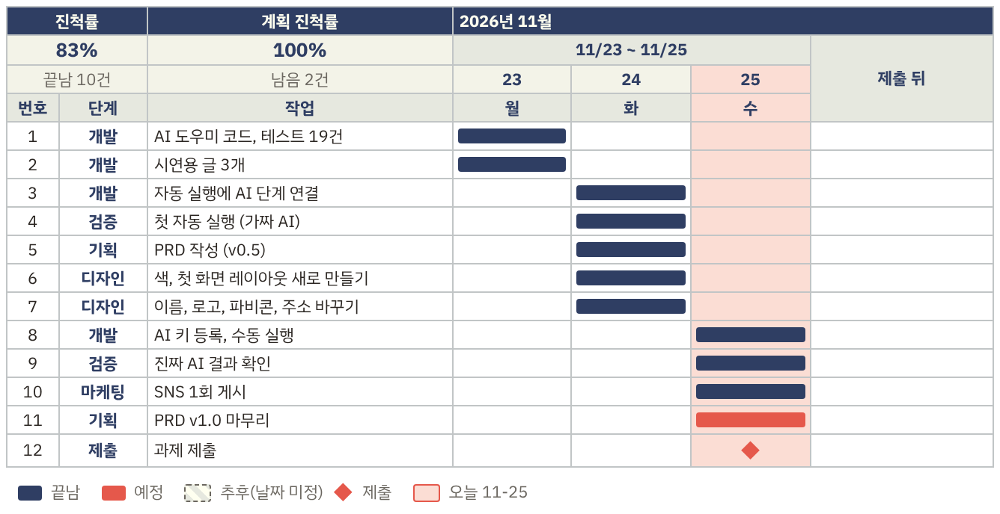

# 삼색펜(가제) AI 도우미 PRD

2026-11-24 (KST)

**문서 버전 v0.3** · "삼색펜"은 가제(임시 이름)

> 이 파일은 Claude Docs 에서 쓴 기획서를 옮긴 것이다. 원본 문서가 바뀌면 이 파일도 다시 옮긴다. PDF 는 `PRD-ai-assist.pdf`.

## 1. 개요

관리자가 글마다 손으로 하던 홍보 준비를 AI 가 미리 해 둔다: 제목 후보, 태그, SNS 문구, 독자용 3줄 요약. 지금은 가짜 AI 결과이고 진짜 키는 11-25. 예산 0원. [요약 보이는 글](https://mopnt135.github.io/test-261117/p/demo-1/) · [관리자 보고서](https://mopnt135.github.io/test-261117/ai/) · [저장소](https://github.com/mopnt135/test-261117)

## 2. 문제

> **문제 정의**
>
> **사용자:** 혼자 블로그를 운영하며 수업 복습 노트를 올리는 관리자 1명. 그 글을 읽는 수업 동기와 지인은 부 사용자다.
>
> **문제:** 글을 올린 직후 제목, 태그, 홍보 문구를 매번 손으로 만들어야 한다. 번거로워 홍보를 미루고, 글이 독자에게 닿지 않는다. 독자는 긴 노트의 핵심을 미리 알 수 없어 중간에 나간다.
>
> **해결 방안:** 글을 올리면 AI 가 제목 후보, 태그, SNS 문구, 3줄 요약을 미리 만들어 둔다. 관리자는 골라서 붙이기만 하고, 독자는 요약을 보고 읽을지 정한다.

| 단계 | 내용 |
| --- | --- |
| 데스크리서치 | 노트가 길고 핵심이 흩어짐. 글 위 AI 요약은 흔한 형태 [확인 필요] |
| 문제 발굴 | 글마다 홍보 준비가 반복됨. 독자 이탈은 부차 문제 |
| 문제 검증 | 숫자 근거 없음. 11-25 에 손과 AI 의 준비 시간 비교 |
| 풀지 않는 문제 | 글 내용의 품질, 방문자 늘리기 전반 |

## 3. 해결방안

**글을 올린 뒤 미리 만들기(A안).** 하루 2번 GitHub Actions 가 AI 결과를 파일로 만든다. 네 가지 방법을 비용, 키 안전, 자동화로 비교해 골랐다.

| 대안 | 비용 | 장점 | 단점 |
| --- | --- | --- | --- |
| 아무것도 안 하기 | 0원 | 할 일 없음 | 홍보 준비 문제가 그대로 남는다 |
| **A. 올린 뒤 미리 만들기 (고름)** | 0원, 호출은 글 수만큼 | 독자가 늘어도 비용 그대로, 키는 Secrets 에만 | 새 글은 최대 반나절 늦게 반영 |
| B. 독자가 열 때마다 AI 호출 | 독자 수만큼 늘어남 | 항상 최신 | 키를 숨길 서버가 필요, 무료 한도를 금방 넘음 |
| C. AI 채팅에 직접 붙여 넣기 | 0원 | 만들 것 없음 | 글마다 손이 가서 문제를 풀지 못함 |

| 장면 | ASIS | TOBE |
| --- | --- | --- |
| 관리자 | 제목, 태그, 문구를 손으로 | 보고서에서 골라 복사 |
| 독자 | 긴 본문부터 | 3줄 요약 보고 읽을지 결정 |

## 4. 가설 및 지표

**가설:** 홍보 재료를 미리 만들어 두면 관리자가 글 하나를 10분 안에 홍보한다.

| 핵심 지표 | 목표 | 11-24 | 11-25 |
| --- | --- | --- | --- |
| 홍보 준비 시간 (주 지표) | 10분 이하 | 측정 전 | [채울 곳] |
| 진짜 AI 결과 | 1건 이상 | 0건 | [채울 곳] |
| 끝까지 읽기 비율 (독자, 참고용) | 요약 있는 글과 없는 글 비교 | GA4 `has_ai_summary` 등록 전 | [채울 곳] |

끝까지 읽기 비율은 방문자가 적어 이번 기간에는 참고용이다. 추세는 제출 뒤에도 계속 본다.

**고객:** 관리자, 수업 동기와 지인. **메시지:** "오늘 수업 핵심, 3줄 요약으로 먼저 보세요."

## 5. 기능적 요구사항

**됨:** 글 위 AI 요약 상자와 안내, 글이 바뀌면 예전 요약 숨김, 관리자 보고서(제목 3, 태그 5, SNS 문구), 하루 2번 자동 실행. **안 됨:** 진짜 AI 결과(키 11-25). **일부:** GA4 요약 유무 비교(등록 전).

## 6. 디자인 요구사항

요약 상자는 연파랑 바탕에 남색 글자. 휴대폰 390px, 누르는 곳 44px 이상. **디자인은 추가로 수정할 예정이다.**

## 7. 출시 및 운영 전략

**위험:** 키가 제출 당일에 옴, 무료 등급 데이터 조건 [확인 필요]. **그만둘 기준:** 돈이 들면 AI 단계를 끈다.

## 8. 일정 및 리소스

**리소스:** 관리자 1명과 AI 코딩 도구. GitHub Actions, GitHub Pages, Gemini 무료 등급, GA4. 모두 0원.

